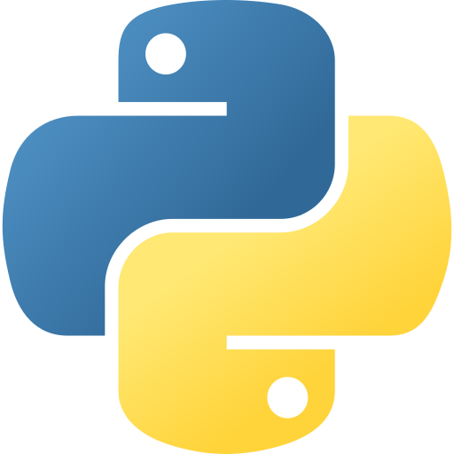

  

<h1 align="center">Actividades de Python</h1>

  
  
  

Repositorio de actividades y ejercicios realizados durante el módulo optativo de Python de 2.º ASIR B.

---

## Contenido

### 

- 
- 
- 
- 

---

### 

#### 

- 
- 

#### 

- 
- 
- 
- 
- 
- 
- 
- 

#### 

- 

#### 

- 

---

### 

- 
- 
- 
- 
- 

---

### 

- 